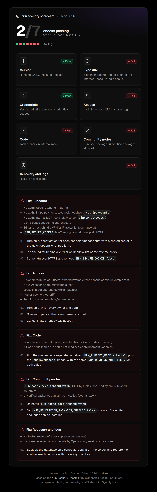
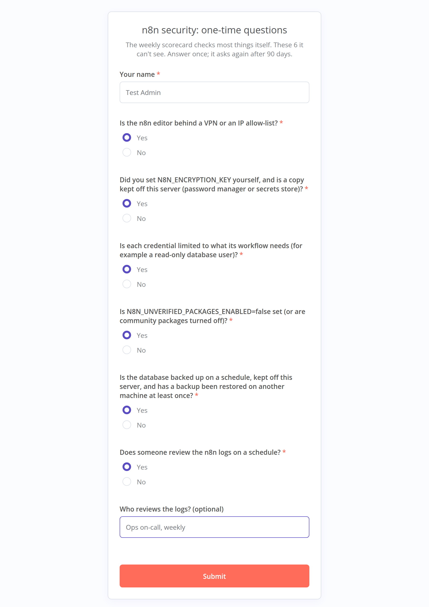
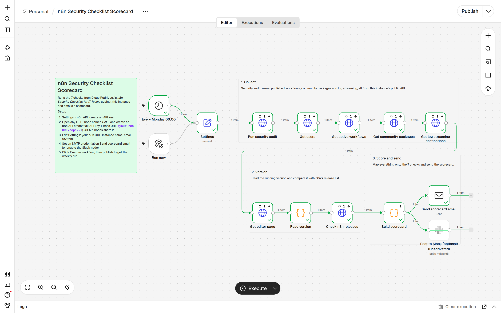

# n8n Security Checklist Scorecard

An n8n workflow that checks your self-hosted n8n against the 7 checks in
Diego Rodriguez's [n8n Security Checklist for IT Teams](https://symplytics.com/blog/n8n-security-checklist)
and emails you a scorecard every week.

Every check comes back as **Pass** or **Fail**, with what it found and how to
fix each failure. Most of it is read straight from your instance. The few
things n8n can't see (where the encryption key is kept, whether a backup was
ever restored) you answer once in a short form. The scorecard reuses those
answers and asks again after 90 days.



*Sample from a test instance seeded with open webhooks, an admin without 2FA,
a shared-looking login, internal task runners and an unused community node.*

## What it checks

| # | Check | Read from your instance | From your one-time answers |
|---|---|---|---|
| 1 | Version | Running version vs. n8n's release list. Fails on a pending security fix, or when you've been behind for more than 28 days. | — |
| 2 | Exposure | Every Webhook, Form, MCP Server and public Chat trigger in published workflows; fails on any without authentication. Fails if the login cookie isn't marked secure. | Is the editor behind a VPN or IP allow-list? |
| 3 | Credentials | Credentials no workflow uses (from n8n's built-in security audit). | Was `N8N_ENCRYPTION_KEY` set by you, with a copy off the server? Are credentials scoped? |
| 4 | Access | Owners and admins, who has 2FA, shared-looking logins (`admin@`, `ops@` …), pending invites. Fails on more than 3 owners/admins, an admin without 2FA, or a shared login. | — |
| 5 | Code | Task runner mode (internal or external) and whether workflow code can read server environment variables, both tested by a Code node during the run. | — |
| 6 | Community nodes | Installed packages, version, author, and whether any published workflow uses them. Fails on unused packages. | Is `N8N_UNVERIFIED_PACKAGES_ENABLED=false` set? |
| 7 | Recovery and logs | Log streaming destinations, where your plan has them. | Has a backup been restored on another machine? Does someone review the logs? |

The two limits (3 owners/admins, 28 days behind) are in the **Settings** node.

### What it can't read, and why

- **Encryption key.** The key lives in an environment variable or in n8n's
  own config folder, and workflows can't read either (that's a safety default
  worth keeping). Whether a copy is stored off the server is invisible from
  inside n8n anyway, so it's a form question.
- **`N8N_UNVERIFIED_PACKAGES_ENABLED`.** n8n only shows this setting to a
  logged-in browser session, not to an API key. Form question.
- **VPN / IP allow-list in front of the editor.** That's a property of your
  network, not of n8n. Form question.
- **Backups and log review.** Outside n8n entirely. Form question (log
  streaming is detected automatically on plans that include it).
- **2FA enforcement.** The instance-wide "require 2FA" switch is a paid feature
  and isn't exposed to the API. The scorecard checks each owner and admin's 2FA
  instead, which is what the checklist asks for.

The workflow never needs Execute Command, file access or env access turned on.

## Setup (about 5 minutes)

1. **Import.** In n8n, create a new workflow, open the **…** menu, choose
   **Import from URL** and paste:

   ```
   https://raw.githubusercontent.com/Pankaj3112/n8n-security-scorecard/main/workflow.json
   ```

   Or copy [`workflow.json`](workflow.json) and paste it onto the canvas.

2. **Connect the n8n API.** Create an API key in **Settings > n8n API** (an
   owner's or admin's key). Open any **Get …** node and create an **n8n API**
   credential with that key and your base URL
   (`https://your-n8n.example.com/api/v1`). All the API nodes share it. On plans
   with key scopes, give it `securityAudit:generate`, `user:list`,
   `workflow:list`, `communityPackage:list` and (optional)
   `eventBusDestination:list`.

3. **Set up the email.** In the **Settings** node, set `n8nUrl` (your n8n's
   address), a name for the instance, and the to/from addresses. Add an SMTP
   credential to **Send scorecard email**, or enable **Post to Slack
   (optional)** instead.

4. **Answer the one-time questions.** Publish the workflow, then open
   `<your n8n URL>/form/n8n-security-answers`. The form only opens for
   logged-in n8n users who can run this workflow; n8n asks you to allow it the
   first time. Answer the 6 yes/no questions. The answers are saved in a data
   table called `n8n_security_answers`.

Click **Execute workflow** for the first scorecard. After that it arrives every
Monday at 08:00. If you skip step 4, the checks that need answers show
**Needs answers** with a link to the form; everything else is still scored.





## What it sends where

- Everything runs inside your n8n. It reads your own API, your editor page (for
  the version number) and your public login settings.
- The only outside call the workflow makes is `GET https://api.n8n.io/api/versions/<your version>`,
  the same release list n8n's own update notices use.
- The email's icons are small PNGs loaded from this repo on GitHub
  (`assets/icons/`, rendered from [Lucide](https://lucide.dev)). Change
  `ICON_BASE` in the **Build scorecard** node to host them yourself.
- The scorecard contains workflow names, webhook paths and user emails. Send it
  somewhere that's fine to hold those.

## Limits

- A webhook with Authentication set to None that checks a signature in the next
  node is listed separately, not as a Fail. Make sure that check is real.
- The shared-login check only looks at the email address, so it can miss shared
  accounts and flag ones that aren't shared.
- Task runner mode is read from where a Code node's own stack trace says the
  runner lives. It was tested with the standard Docker image in both internal
  mode and external mode (`n8nio/runners`); on unusual installs it may report
  "not detectable".
- Tested on n8n 2.48.7 (self-hosted, Docker, Community Edition). The form uses
  the Form Trigger's "n8n User Auth" option, which needs a recent 2.x release.

## Credit

The checklist is Diego Rodriguez's
[n8n Security Checklist for IT Teams](https://symplytics.com/blog/n8n-security-checklist).
Read it for the reasons behind each check. This workflow is an independent
build that automates those checks. It is not made by, for, or with Symplytics.

## Development

`workflow.json` is generated. Edit the sources in `src/` and run
`python3 src/build.py`.

## License

[MIT](LICENSE)
